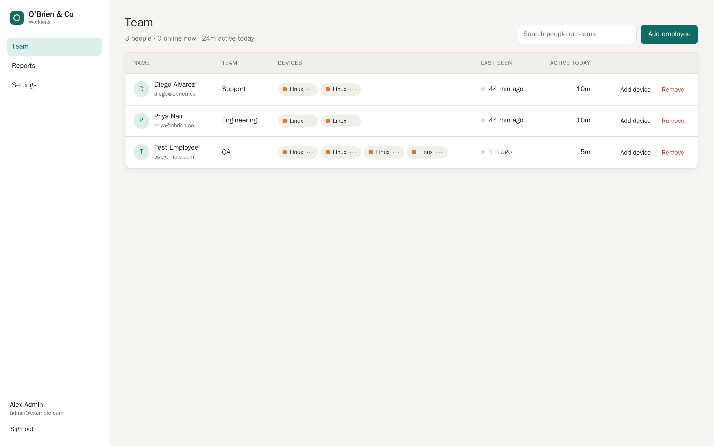
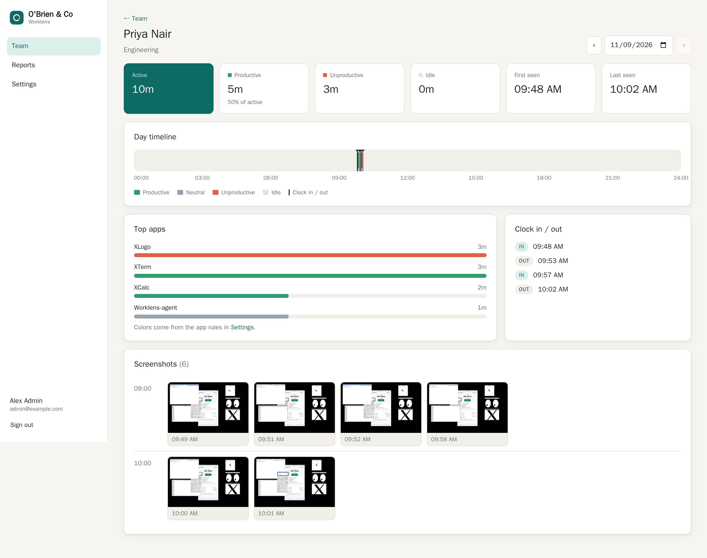
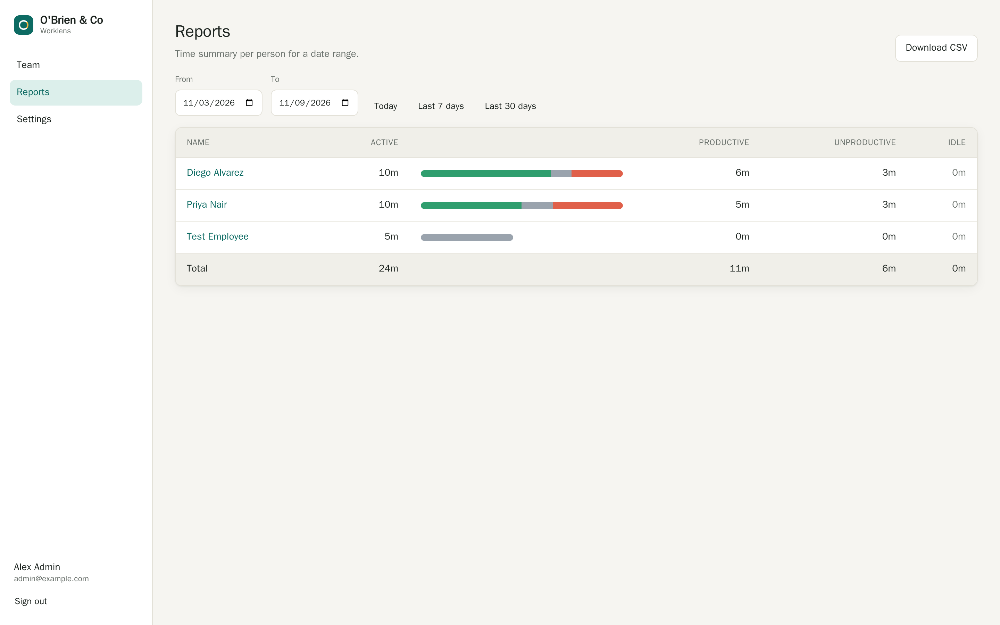

<div align="center">


### Open-source, self-hosted employee monitoring & time tracking for Windows, macOS, and Linux

A free, privacy-respecting alternative to Hubstaff, Time Doctor, Insightful, and We360.ai — that you run on your own server and fully own.

[](LICENSE)
[](#quick-start)
[](agent/)
[](server/)
[](dashboard/)
[](#cross-platform-agents)

[](https://github.com/Mrhudson69/openv360/commits/main)
[](https://github.com/Mrhudson69/openv360/stargazers)
[](https://github.com/Mrhudson69/openv360/issues)
[](CONTRIBUTING.md)


</div>

---

# openv360 — open-source employee monitoring & time-tracking software you self-host

**openv360** is a free, **open-source, self-hosted employee monitoring and time-tracking** platform for **Windows, macOS, and Linux**. It gives teams automatic **time tracking**, **activity and app monitoring**, configurable **screenshot monitoring**, **attendance and timesheets**, **productivity analytics**, and **workforce reporting** — without a per-seat SaaS subscription and without handing your employees' data to a third party. Deploy it on your own server in one command, keep every screenshot and activity record on infrastructure you control, and read the whole source. If you've been looking for an **open-source Hubstaff alternative**, a **self-hosted Time Doctor alternative**, or **screenshot monitoring software that is open source**, openv360 is built for exactly that.

Monitoring is **transparent by design**: the desktop agent is always visible in the system tray, only records while an employee is clocked in, and shows what is being captured. You own the data; your team can see the agent working.

> **Status:** v0.1.0 (beta). Usable and self-hostable today; expect rough edges and breaking changes before 1.0.

## Screenshots

### Team overview — live activity, productivity, and who's working now


### Per-employee day view — zoomable timeline, activity log, and screenshot gallery


### Reports — timesheets, productivity, and one-click CSV export


## Features

Everything you need to run **workforce analytics and employee time tracking** on your own infrastructure.

- **Automatic time & activity tracking** — Captures worked time, active application, and window title, and distinguishes active from idle time. No manual timers required; employees just clock in.
- **Screenshot monitoring (configurable)** — Periodic screenshots at an interval you choose, with optional **blur** for privacy and automatic **retention**/cleanup. Turn it off entirely per deployment.
- **Multi-monitor capture** — Dual/triple-screen setups are captured in full and **stitched into one screenshot**, automatically, on every OS.
- **Idle detection (no keylogging)** — Uses the OS idle timer only (no keystroke or mouse-content logging) to separate focused work from away/idle periods, so timesheets reflect real activity.
- **Meetings count as work** — Time spent in a live call (Zoom, Google Meet, Microsoft Teams, Slack huddle, Webex…) counts as active even when you're only listening — not logged as idle.
- **Per-team productivity rules** — Classify applications and sites as productive, neutral, or unproductive, with **different rules per team**, and roll it up into productivity scores. Mark an app productive **org-wide in one click** from the Top-apps view.
- **Teams & roles** — Organize people into teams with role-based access: **owner** and **team-manager**, so managers see only their own team.
- **Attendance & timesheets** — Clock-in/out, worked hours, and attendance views across the day, week, and custom ranges.
- **Reports & CSV export** — Worked-hours, activity, and productivity reports you can filter and export to **CSV** for payroll or analysis.
- **Alerts** — Get notified via **Slack, webhook, or email** on the conditions you care about.
- **Scheduled email reports** — Automated recurring report emails via your own SMTP server (SSL/TLS, cert verification, test send).
- **Dashboards** — Overview, team, and per-employee **Day/Week** views with a **zoomable timeline** (drag to filter a range), a **filterable activity log**, a **screenshot gallery**, and tabbed Screenshots / Top-apps / Activity / Clock-in-out.
- **Full rebranding (white-label)** — Change the product name, colors, and logo to match your organization.
- **Cross-platform desktop agents** — One agent for **Windows, macOS, and Linux** (Ubuntu 24.04 & 26.04 first-class), built in Rust + Tauri 2 as a small native binary.
- **One-command, self-healing auto-update** — Agents update themselves within ~1 hour of a release (no manual rollout); the server auto-detects the latest version. Update the server in place with `openv360 update`.
- **Never loses data, never silently offline** — The agent queues activity and screenshots locally and retries forever through any outage; it **never auto-disconnects** on a transient server error, a self-healing watchdog recovers from a hang/crash, and a bad record can't jam the queue. When the server returns, the backlog flushes.
- **Runs on always-on & headless machines** — Designed for 24/7 cloud/remote hosts: it stays quiet when a session is locked, RDP is disconnected, or there's no desktop.
- **Transparent anti-tamper** — Always-visible tray icon; records only while clocked in; **no covert/hidden-process behavior**. On managed devices an optional watchdog **respawns the agent if it's force-quit**, while the admin can always remove it cleanly from the dashboard.
- **Self-hosted, with your choice of TLS** — One-command setup with Docker Compose + **automatic HTTPS (Caddy + Let's Encrypt)**, or run **behind your existing nginx/Traefik** reverse proxy. Your data never leaves your server.

## Why openv360?

Proprietary workforce-monitoring SaaS charges per seat every month, stores your employees' screenshots and activity on their cloud, and keeps the source closed. openv360 flips that.

| | openv360 | Proprietary SaaS (Hubstaff / Time Doctor / Insightful / We360.ai) |
|---|---|---|
| **Hosting** | Self-hosted on your server | Vendor cloud |
| **Pricing** | Free, no per-seat fee | Per-user, per-month |
| **Your data** | Stays on infrastructure you own | Held by the vendor |
| **Source code** | Open (MIT), auditable | Closed |
| **Rebranding** | Full white-label included | Paid add-on or unavailable |
| **Cross-platform agent** | Windows, macOS, Linux | Varies |
| **Transparency** | Always-visible agent, open about what's captured | Varies |

## Quick start

You need a Linux server (Ubuntu 22.04 / 24.04 / 26.04 or Debian 12+) with a domain name or public IP. Everything else is installed for you.

### 1. Install the server (one command)

```sh
curl -fsSL https://raw.githubusercontent.com/Mrhudson69/openv360/main/deploy/setup-server.sh | sudo bash
```

This installs Docker, PostgreSQL, the openv360 server and dashboard, and provisions **automatic HTTPS** (Caddy + Let's Encrypt). It asks for your organization name, domain, and the first admin account, then prints your dashboard URL.

> **Already run nginx / Traefik / another reverse proxy?** Add `--no-caddy` to skip the bundled Caddy and run openv360 behind your proxy: `… | sudo bash -s -- --no-caddy`. See the [reverse-proxy deployment guide](docs/deployment/reverse-proxy.md) for nginx/Traefik examples and shared-network setup.

Prefer to run it yourself? Clone the repo and use Docker Compose:

```sh
git clone https://github.com/Mrhudson69/openv360.git
cd openv360
cp .env.example .env            # set POSTGRES_PASSWORD and other secrets
docker compose up -d            # server + PostgreSQL
# For automatic HTTPS in front of it, use the Caddy overlay:
docker compose -f docker-compose.yml -f deploy/docker-compose.caddy.yml up -d
```

### 2. Add an employee and install the agent

In the dashboard, add an employee to generate a one-time enrollment code (`XXXX-XXXX`). Then, on the employee's computer, run a single line.

**macOS / Linux:**

```sh
curl -fsSL https://YOUR-SERVER/install.sh | sh -s -- --code XXXX-XXXX
```

**Windows (PowerShell):**

```powershell
& ([scriptblock]::Create((irm https://YOUR-SERVER/install.ps1))) -Code XXXX-XXXX
```

The agent downloads, installs (per-user — no admin needed), connects to your server, and starts tracking — always visible in the tray. On macOS it asks for Screen Recording permission on first launch and detects the grant live (no restart needed).

### 3. Keeping it updated

**Server** — update in place; data and secrets are preserved:

```sh
sudo openv360 update      # git pull + rebuild + restart
openv360 status           # health, version, and management commands
```

(`openv360` also supports `logs`, `restart`, `stop`, `start`, and `backup`.)

**Agents** update themselves — within about an hour of a new release, with no action per machine (the server auto-detects the latest version from GitHub Releases). To push an update to a device immediately, restart its agent; it checks ~60 s after launch. Air-gapped servers can pin the version with `OPENV360_LATEST_VERSION` in `.env`.

**Uninstall an agent** — remotely from the dashboard (**Uninstall agent**), or locally with the uninstaller (`uninstall.sh` / `uninstall.ps1`).

## How it works

```
┌─────────────────┐        HTTPS         ┌──────────────────┐        ┌──────────────────┐
│  Desktop agent  │   activity, apps,    │   openv360 server │        │  Admin dashboard │
│  (Rust + Tauri) │ ───screenshots────▶  │ (Node + Fastify)  │ ◀────▶ │ (React + Vite)   │
│  Win/macOS/Linux│    offline-queued    │   + PostgreSQL    │        │  teams, reports  │
└─────────────────┘                      └──────────────────┘        └──────────────────┘
```

1. The **agent** runs on each employee's device, records time/app/idle/screenshots while clocked in, and syncs to the server (queuing and retrying when offline).
2. The **server** stores activity and settings in PostgreSQL and screenshots on disk, and exposes the API.
3. The **dashboard** is where admins and team managers view activity, manage teams and rules, run reports, and configure alerts.

On Linux/Wayland the agent uses a bundled GNOME Shell extension plus `xdg-desktop-portal` to capture screenshots.

## Tech stack

| Part | Stack | Folder |
|------|-------|--------|
| Desktop agent | Rust + Tauri 2 (small native binary) | [`agent/`](agent/) |
| Server API | Node 26 + Fastify 5 + PostgreSQL | [`server/`](server/) |
| Admin dashboard | React 19 + Vite | [`dashboard/`](dashboard/) |
| Linux Wayland helper | GNOME Shell extension + xdg-desktop-portal | [`linux/gnome-extension/`](linux/) |
| Background service units | systemd / launchd / Scheduled Task | [`linux/systemd/`](linux/), [`installer/`](installer/) |
| One-command installers | shell / PowerShell | [`installer/`](installer/) |
| Server bootstrap | script, Docker Compose, Caddy | [`deploy/`](deploy/) |

## Project structure

```
openv360/
├── agent/              # Cross-platform desktop agent (Rust + Tauri 2)
│   ├── src-tauri/      # Rust backend, Tauri config, bundling
│   └── ui/             # Agent tray/status UI
├── server/             # Node 26 + Fastify 5 API
│   ├── src/            # Routes, services, data access
│   ├── migrations/     # PostgreSQL schema migrations
│   └── test/           # Vitest test suite
├── dashboard/          # React 19 + Vite admin UI
├── linux/              # GNOME Shell extension + systemd units
├── installer/          # install.sh / install.ps1 (+ uninstall)
├── deploy/             # setup-server.sh, Caddy, Compose overlays
├── docs/               # Screenshots, assets, API docs
├── docker-compose.yml  # Server + PostgreSQL
└── Dockerfile          # Server image
```

## Security & privacy

openv360 is **employee-monitoring software**, and it is built to be used transparently and lawfully.

- **Hashing & encryption** — Admin passwords use **scrypt** (random salt + constant-time compare); device and session tokens are **SHA-256-hashed**; the SMTP password is **AES-256-GCM encrypted at rest**. Owners can reset other admins' passwords; managers can change their own.
- **Transport** — The deployment path provisions **automatic HTTPS** (Caddy + Let's Encrypt), so agent-to-server traffic is encrypted. Agent self-update refuses to run over plain HTTP.
- **No keylogging** — Idle is derived from the **OS idle timer only**. openv360 never records keystrokes or mouse content.
- **Transparency** — The agent is **always visible** in the system tray, records **only while clocked in**, and does **not** hide its process or capture covertly. The anti-tamper respawn keeps a visible agent running on managed devices; it is **not** stealth, and the admin can remove it at any time.
- **Least privilege** — Team managers are scoped to their own team only; owner-only actions are enforced server-side.
- **Data ownership** — Everything is stored on **your** server: activity in PostgreSQL, screenshots on disk, with configurable **retention**.

To report a vulnerability, see [SECURITY.md](SECURITY.md).

## ⚖️ Legal & responsible use

> **openv360 is for transparent, lawful workplace monitoring only. You are solely responsible for how you use it, and the maintainers accept no liability for your use.**

- **No warranty, no liability.** The software is provided "as is" under the [MIT License](LICENSE). The authors, maintainers, and contributors are **not responsible or liable** for how you deploy or use openv360, for the data you collect, or for any legal consequences, disputes, or damages arising from your use. **You use it at your own risk.**
- **Lawful use is your responsibility.** Monitoring, recording, and data-protection laws vary by country, state, and region (e.g. GDPR, CCPA/CPRA, ECPA/wiretap and two-party-consent laws, works-council rules). Many **require that you inform, and in some cases obtain consent from, the people being monitored.** You are the data controller and must comply with every law that applies to you.
- **Intended use.** Employer-managed devices, monitored employees who **know** it is running. openv360 is built to be visible on purpose.
- **Prohibited.** Covert surveillance, stalkerware, or monitoring any person/device you are not legally authorized to monitor.
- **Not legal advice.** Consult a qualified lawyer before deploying workplace monitoring.

**Full terms: [DISCLAIMER.md](DISCLAIMER.md).** By using openv360 you agree to them.

## Contributing

Contributions are welcome. See [CONTRIBUTING.md](CONTRIBUTING.md) for local setup (server, dashboard, agent), how to run the tests, coding conventions (TypeScript strict, clippy-clean Rust, Conventional Commits), and the pull-request process. Please also read our [Code of Conduct](CODE_OF_CONDUCT.md).

## Roadmap

- [x] Cross-platform agent (Windows, macOS, Linux)
- [x] Time, app, idle, and multi-monitor screenshot tracking
- [x] Meetings (Zoom / Meet / Teams / …) counted as active work
- [x] Teams, roles, and per-team productivity rules
- [x] Attendance, reports, and CSV export
- [x] Alerts (Slack / webhook / email) and scheduled reports
- [x] Full rebranding / white-label
- [x] One-command self-hosted deploy — automatic HTTPS **or** behind your own nginx/Traefik
- [x] Self-healing agents (never lose data, never silently offline) + one-command auto-update
- [x] Transparent anti-tamper respawn on managed devices
- [ ] 1.0 stabilization and migration guarantees
- [ ] Mobile companion / activity on mobile
- [ ] More integrations (payroll, project tools)
- [ ] Richer analytics and custom report builder
- [ ] Localization / i18n

## License

[MIT](LICENSE) © openv360 contributors.

---

<sub>**Keywords:** open source employee monitoring, self-hosted time tracking, open source Hubstaff alternative, self-hosted Time Doctor alternative, screenshot monitoring software open source, workforce analytics self hosted, employee activity tracking, open source Insightful alternative, We360.ai alternative, self-hosted productivity monitoring, time and attendance tracking, Windows macOS Linux employee monitoring agent.</sub>
